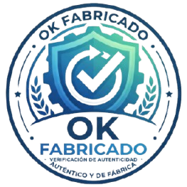
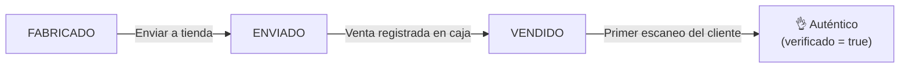

<p align="center">
  
</p>

<h1 align="center">OK Fabricado</h1>

<p align="center">
  Verificación de autenticidad de productos mediante QR.<br>
  Cada unidad se verifica <strong>una sola vez</strong> y <strong>solo si fue vendida en una tienda oficial</strong>.
</p>

<p align="center">
  
  
  
</p>

---

## ¿Qué problema resuelve?

Un QR común no prueba nada: se fotografía y se copia en miles de productos falsos. **OK Fabricado** conecta cada unidad física
(un bolso, una cartera, unas botas) con un registro único en el servidor y exige que la **tienda confirme la venta** antes de
que el cliente pueda recibir el 👌. Además, esa verificación se puede usar **una sola vez**, y cualquier intento sospechoso
queda registrado para la marca.

## ¿Cómo funciona?



1. **Fábrica:** genera un lote. Cada unidad recibe un código de fábrica (`BR-2026-000123`) y un QR con un token aleatorio
   imposible de adivinar.
2. **Tienda:** el cajero registra la venta con el código de la etiqueta (a mano o con un lector de código de barras).
3. **Cliente:** escanea el QR, pulsa **Verificar autenticidad** y recibe la respuesta.

| Situación | Respuesta al cliente |
|---|---|
| Vendido en tienda oficial, primera verificación | 👌 **Auténtico**, con código, modelo, tienda y fecha de venta |
| Ya fue verificado antes | ⚠️ **Ya fue verificado**, con la fecha de la primera vez |
| Aún no figura como vendido | ❌ **No figura como vendido** |
| El código no existe | ❌ **No auténtico** |

Todos los intentos (buenos o sospechosos) quedan en la pantalla de **Alertas**.

## Funcionalidades

- Generación de lotes de productos con código de fábrica y token seguro por unidad.
- Estados del producto: `FABRICADO` → `ENVIADO` → `VENDIDO`.
- Verificación pública de una sola vez, sin necesidad de cuenta para el cliente.
- Bitácora de escaneos con resaltado de intentos sospechosos.
- **Etiquetas en PDF** listas para imprimir (27 por hoja A4):
  - *Con QR*, para ocultar dentro del producto.
  - *Con código de barras (Code 128)*, visible, para que la caja la lea.
- Panel de administración: modelos, tiendas y usuarios.
- Tres roles con permisos separados: `ADMIN`, `FABRICA` y `TIENDA`.
- Interfaz responsive con modo claro y oscuro.

## Decisiones de diseño destacadas

- **El "solo una vez" lo decide la base de datos, no el código Java.** Se usa un `UPDATE` condicional atómico
  (`WHERE verificado = false AND estado = 'VENDIDO'`) que devuelve 1 fila para quien gana y 0 para el resto. Dos escaneos
  simultáneos no pueden obtener ambos el 👌.
- **Abrir el enlace del QR no consume la verificación.** Aplicaciones como WhatsApp, los antivirus y las vistas previas abren
  enlaces por su cuenta. Por eso el `GET` solo muestra un botón y la verificación ocurre en un `POST`, seguido de una redirección
  (patrón Post/Redirect/Get) para que recargar la página no gaste nada.
- **Dos tipos de etiqueta.** Un QR visible puede fotografiarse antes de la compra, así que el QR va oculto en el producto y la
  caja trabaja con un código de barras aparte.
- **Tokens criptográficos.** 24 bytes de `SecureRandom` codificados en Base64 URL-safe, validados con una expresión regular
  antes de consultar la base de datos.
- **Seguridad básica.** Contraseñas con BCrypt, protección CSRF, rutas separadas por rol y la bitácora guarda solo un
  fragmento del token.
- **Reglas que protegen el historial.** No se puede eliminar un modelo con productos fabricados, una tienda con ventas o
  usuarios asignados, ni al último administrador.

## Tecnologías

| Área | Herramientas |
|---|---|
| Lenguaje y framework | Java 21, Spring Boot 4.1 |
| Persistencia | Spring Data JPA / Hibernate, MySQL (o H2 en memoria para pruebas) |
| Seguridad | Spring Security (roles, BCrypt, CSRF) |
| Vistas | Thymeleaf y `thymeleaf-extras-springsecurity` |
| QR y códigos de barras | ZXing 3.5 |
| PDF | Apache PDFBox 3.0 |
| Construcción | Maven (incluye el wrapper `mvnw`) |

## Cómo ejecutarlo

**Requisitos:** JDK 21. MySQL es opcional.

### Opción A: sin instalar base de datos (H2 en memoria)

```bash
./mvnw spring-boot:run -Dspring-boot.run.profiles=h2
```

Los datos se borran cada vez que detienes la aplicación.

### Opción B: con MySQL

```bash
export DB_USER=root
export DB_PASSWORD=tu_clave
./mvnw spring-boot:run
```

La base `autenticidad` se crea sola. Si no defines las variables, se usa `root` / `root`.

Luego abre **http://localhost:8081**.

### Probarlo desde un celular en tu red local

El QR contiene la dirección configurada en `app.base-url`, que por defecto es `localhost` y un celular no puede abrirla.
Arranca indicando la IP de tu computadora y **genera un lote nuevo** (los QR anteriores conservan la dirección vieja):

```bash
APP_BASE_URL=http://192.168.1.50:8081 ./mvnw spring-boot:run -Dspring-boot.run.profiles=h2
```

El celular debe estar en la misma red wifi, y el firewall debe permitir conexiones al puerto 8081.

## Usuarios de demostración

Se crean automáticamente la primera vez que arranca la aplicación (clase `DatosIniciales`).

| Rol | Email | Contraseña |
|---|---|---|
| `ADMIN` | admin@demo.com | admin123 |
| `FABRICA` | fabrica@demo.com | fabrica123 |
| `TIENDA` | caja@demo.com | caja123 |

> ⚠️ Son solo para desarrollo. Elimina la clase `DatosIniciales` antes de publicar y crea los usuarios reales desde
> **Administración > Usuarios**.

## Recorrido de prueba

1. Entra como `fabrica@demo.com`, ve a **Fábrica** y genera un lote.
2. Pulsa **Enviar a tienda** en un producto y anota su código (por ejemplo `BR-2026-000001`).
3. Cierra sesión, entra como `caja@demo.com`, escribe ese código en **Caja** y pulsa *Cobrar y marcar vendido*.
4. Escanea el QR del producto (o abre `/v/<token>`) y pulsa **Verificar autenticidad**: 👌.
5. Vuelve a escanear: ⚠️ ya verificado. Prueba con un producto sin vender: ❌. Revisa todo en **Alertas**.

<!-- Capturas sugeridas (guárdalas en docs/ y descomenta):


-->

## Rutas principales

| Ruta | Acceso | Descripción |
|---|---|---|
| `/v/{token}` | Público | Pantalla con el botón de verificar (abre el QR) |
| `/v/{token}/resultado` | Público | Resultado de la verificación |
| `/login`, `/panel` | Público / autenticado | Ingreso y menú según el rol |
| `/fabrica` | `FABRICA`, `ADMIN` | Lotes, envíos y descarga de etiquetas |
| `/caja` | `TIENDA` | Registro de ventas |
| `/alertas` | `FABRICA`, `ADMIN` | Bitácora de escaneos |
| `/admin/modelos`, `/admin/tiendas`, `/admin/usuarios` | `ADMIN` | Administración |
| `/qr/{token}` | `FABRICA`, `ADMIN` | Imagen PNG del QR |

## Estructura del proyecto

```
src/main/java/com/egg/autenticidad/
├── configuracion/   Seguridad web y datos de demostración
├── controladores/   Pantallas y endpoints (MVC)
├── dto/             Objetos de transferencia (VerificacionDTO)
├── entidades/       Producto, Modelo, Tienda, Usuario, Escaneo + enumeraciones
├── excepciones/     MiExcepcion (errores de negocio con mensaje para el usuario)
├── repositorios/    Spring Data JPA
└── servicios/       Reglas de negocio: verificación, productos, etiquetas, QR...
src/main/resources/
├── templates/       Vistas Thymeleaf (incluye admin/)
└── static/          CSS y logo
```

## Limitaciones conocidas y próximos pasos

Es un **prototipo**: sirve para validar el flujo completo, pero todavía no está listo para producción.

- [ ] Límite de intentos por IP en `/v/**` (evita probar tokens al azar y llenar la bitácora).
- [ ] Pruebas automáticas, sobre todo de `VerificacionServicio` con escaneos simultáneos.
- [ ] Despliegue con dominio propio y **HTTPS** (y `app.base-url` apuntando a ese dominio).
- [ ] Integración con el sistema de caja (POS) mediante una API, en lugar del registro manual.
- [ ] **NFC con firma criptográfica** (por ejemplo NTAG 424 DNA) como alternativa más difícil de copiar que el QR.
- [ ] Gestión de lotes como entidad propia y exportación de reportes.

Una limitación inherente al QR: si alguien ve el código antes de la compra, podría usar la verificación. Por eso las etiquetas con
QR están pensadas para ir ocultas dentro del producto, y la segunda etapa propone NFC.

## Licencia

Por definir 

## Autor

**Dante Trabalon**, proyecto desarrollado para aprender y aplicar Java, Spring Boot y Spring Security.
[LinkedIn](https://www.linkedin.com/in/dante-tbn-11055a241/) · [GitHub](https://github.com/dante894/ok-fabricado)
